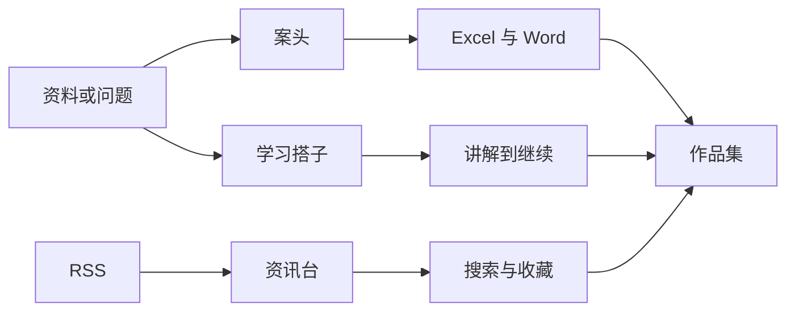

# jjh · AI 设计师

做 AI 产品与工作流的设计型开发者。

A design-minded developer building AI products and workflows.

我是人工智能专业的大一学生，Python 学到 class（类），仍在巩固。现在做的是能打开、能回头检查的小产品：把对话接上文件工具，把资料收成学习步骤，把资讯收成自己的阅读台，再把它们放进作品集。

[作品集](https://jjh-python667.github.io/) · [案头](https://github.com/jjh-python667/antou-office-agent) · [学习搭子](https://github.com/jjh-python667/personal-learning-agent) · [资讯台](https://github.com/jjh-python667/newsdesk)

个人域名 `jjhbuilds.com` 已经登记，目前没有 A / AAAA 记录，浏览器打不开。这里只链到现在可以打开的作品集。

## 简介

这些项目共用一条短路径：先有一份资料或一个问题，再在一个界面里看完讨论、阅读或练习，并把执行结果留下来。

界面尽量一次只做一件事。工具调用、学习步骤和已读状态可以回看。演示数据、模拟模型和还没联调的部分，写在各自仓库里。开发、检查和文档用了 AI 编程助手，能力边界以仓库说明为准。

## 作品

<table>
  <tr>
    <td width="340" valign="top">
      
    </td>
    <td valign="top">
      <strong>案头 · ANTOU</strong> 
      本地办公原型 · v3.2 
       
      在本机把讨论接上文件工具，汇总表格并生成 Excel 与 Word。 
       
      Python · 标准库 HTTP · SQLite · openpyxl · python-docx · 原生 HTML / CSS / JS · GSAP 3.15.1 
      预设 DeepSeek、通义千问、OpenAI、Kimi、硅基流动、Ollama 与自定义兼容接口 
       
      <a href="https://github.com/jjh-python667/antou-office-agent">源码</a>
      ·
      <a href="https://jjh-python667.github.io/projects/antou-office-agent.html">项目页</a>
    </td>
  </tr>
</table>

<table>
  <tr>
    <td width="340" valign="top">
      
    </td>
    <td valign="top">
      <strong>资讯台 · Newsdesk</strong> 
      个人阅读台 
       
      把 AI、科技和商业 RSS 收成自己的阅读台，可以搜索、收藏，并同步已读。 
       
      Cloudflare Workers · D1 · 原生 HTML / CSS / JS · Web Animations API 
      本地预览用 Node.js。没有生产 npm 依赖，也没有默认调用模型 
       
      <a href="https://github.com/jjh-python667/newsdesk">源码</a>
      ·
      <a href="https://jjh-python667.github.io/projects/newsdesk.html">项目页</a>
    </td>
  </tr>
</table>

<table>
  <tr>
    <td width="340" valign="top">
      
    </td>
    <td valign="top">
      <strong>学习搭子 · Personal Learning Agent</strong> 
      公开版本 v0.4.0 
       
      围着自己的资料走「讲解 → 出题 → 答题 → 继续」，任务可以暂停再接着做。 
       
      Python · FastAPI · Uvicorn · SQLite · DeepSeek API · pypdf · 原生网页 
      可选官方 QQ 机器人（qq-botpy）。DOCX 由标准库读取 
       
      <a href="https://github.com/jjh-python667/personal-learning-agent">源码</a>
      ·
      <a href="https://jjh-python667.github.io/projects/personal-learning-agent.html">项目页</a>
    </td>
  </tr>
</table>

<table>
  <tr>
    <td valign="top">
      <strong>作品集 · jjh-python667.github.io</strong> 
      GitHub Pages 静态站点 
       
      把这些作品、截图和学习记录收成一个可以浏览、搜索和筛选的站点。 
       
      静态 HTML / CSS · 原生 JS · 本地打包的 GSAP 3.15.1 · Node.js 构建脚本 · GitHub Pages 
      仓库里没有单独的项目子页，站点首页就是作品集 
       
      <a href="https://github.com/jjh-python667/jjh-python667.github.io">源码</a>
      ·
      <a href="https://jjh-python667.github.io/">作品集</a>
    </td>
  </tr>
</table>

## 笔记

<table>
  <tr>
    <td width="340" valign="top">
      
    </td>
    <td valign="top">
      <strong>笔记 · grokbot-workflow-notes</strong> 
      概念笔记。仓库里是说明文档 
       
      整理连续对话、异步任务和多角色分工，方便对照着自学。 
       
      Markdown。不含密钥、私有技能全文或可运行的产品代码 
       
      <a href="https://github.com/jjh-python667/grokbot-workflow-notes">源码</a>
      ·
      <a href="https://jjh-python667.github.io/projects/grokbot-workflow-notes.html">项目页</a>
    </td>
  </tr>
</table>

## 练习

下面两个仓库是学习练习。

<table>
  <tr>
    <td width="340" valign="top">
      
    </td>
    <td valign="top">
      <strong>练习 · 星球大战 mini</strong> 
      Python / Pygame 入门练习 
       
      参考《Python 编程：从入门到实践》里的「外星人入侵」，改写成的射击小游戏。 
       
      Python · Pygame 
       
      <a href="https://github.com/jjh-python667/star-wars-mini">源码</a>
      ·
      <a href="https://jjh-python667.github.io/projects/star-wars-mini.html">项目页</a>
    </td>
  </tr>
</table>

<table>
  <tr>
    <td valign="top">
      <strong>练习 · python-learning</strong> 
      基础语法记录 
       
      从 <code>hello.py</code> 开始记练习。学到什么再补什么，计划中的内容不写成已经完成。 
       
      Python 
      作品集没有这个练习的单独项目页 
       
      <a href="https://github.com/jjh-python667/python-learning">源码</a>
    </td>
  </tr>
</table>

## 用到的技术

只列这些仓库里实际出现的部分。

| 用在 | 技术 |
| --- | --- |
| 案头 | Python 标准库 `http.server`、SQLite、openpyxl、python-docx、原生 HTML / CSS / JS、随源码打包的 GSAP 与 ScrollTrigger 3.15.1。模型预设为 DeepSeek、OpenAI、通义千问、Kimi、硅基流动、Ollama、自定义兼容接口 |
| 资讯台 | Cloudflare Workers、D1（绑定名 `DB`）、原生 HTML / CSS / JS、`element.animate()`、IntersectionObserver。Node.js 只用于构建和本地预览 |
| 学习搭子 | Python、FastAPI、Uvicorn、Pydantic、SQLite、httpx、pypdf、python-multipart、DeepSeek API、原生网页。可选依赖 qq-botpy。Word 文本用标准库解析 |
| 作品集 | 静态 HTML / CSS、原生 JS、本地打包的 GSAP 3.15.1、Node.js 构建脚本、GitHub Pages |
| 笔记 | Markdown |
| 练习 | Python；星球大战 mini 另外使用 Pygame |

## 正在学

| 顺序 | 内容 | 状态 |
| --- | --- | --- |
| 现在 | Python | 学到 class（类），仍在巩固 |
| 之后 | C / C++ | 准备学 |
| 之后 | 算法 | 准备学 |
| 之后 | NumPy | 准备学 |

目标是能自己解释和修改项目里的关键代码。Python 学到 class（类），仍在巩固。

## 怎么运行

密钥、办公资料和学习数据库都留在本机，不在这些公开仓库里。下面是各仓库 README 里的入口，完整步骤以链接为准。

| 项目 | 入口 |
| --- | --- |
| [案头](https://github.com/jjh-python667/antou-office-agent) | Python 3.9 或更新版本。`python -m pip install -r requirements.txt`，然后 `python app.py`。Windows 可双击 `start.cmd`。服务只监听本机 |
| [资讯台](https://github.com/jjh-python667/newsdesk) | Node.js 20 或更新版本，仓库没有需要安装的生产依赖。`npm run check`，然后 `npm run preview`，在本机打开 `http://127.0.0.1:4173/`。预览使用内存演示数据 |
| [学习搭子](https://github.com/jjh-python667/personal-learning-agent) | 建议 Python 3.11。安装 `requirements.txt` 后执行 `python -m uvicorn main:app --host 127.0.0.1 --port 8000 --workers 1`。把 `.env.example` 复制为 `.env`，填入自己的配置 |
| [作品集](https://github.com/jjh-python667/jjh-python667.github.io) | Node.js 20 或更新版本。`npm run build`，然后 `npm run preview`（默认端口 4176）。线上页面即 [jjh-python667.github.io](https://jjh-python667.github.io/) |
| [练习 · 星球大战 mini](https://github.com/jjh-python667/star-wars-mini) | `python -m pip install pygame`，然后 `python alien_invasion.py` |
| [练习 · python-learning](https://github.com/jjh-python667/python-learning) | `python hello.py` |

## 做到哪一步

| 项目 | 已经核对 | 还要再看 |
| --- | --- | --- |
| 案头 v3.2 | 仓库 README 记录 47 项本地测试。[Tests](https://github.com/jjh-python667/antou-office-agent/actions/workflows/tests.yml) 在 Ubuntu 与 Windows（Python 3.11）上有通过记录。本页截图是无需 Key 的固定演示 | 真实云端 Key 联调，以及在 Microsoft Excel / Word 里看版式 |
| 资讯台 | 2026-11-09 的个人部署回报为 25 个来源中 24 个成功。新版前端完成 24 项本地模拟接口回归。[check](https://github.com/jjh-python667/newsdesk/actions/workflows/check.yml) 有通过记录 | 36氪返回人机验证页。线上是否已经换成这版前端，以及 Access 与 D1 的发布后表现。私人实例只有本人能登录 |
| 学习搭子 v0.4.0 | `VERSION` 与 README 为 v0.4.0。README 记录 51 项本地测试，使用临时数据库和模拟模型。[Python tests](https://github.com/jjh-python667/personal-learning-agent/actions/workflows/tests.yml) 在 Ubuntu / Python 3.11 上有通过记录。本页截图来自 v0.2.0 | 真机整页、真实 QQ、真实 DeepSeek 和线上 HTTPS。GitHub 标签目前到 v0.3.0，没有 v0.4.0 Release |
| 作品集 | [jjh-python667.github.io](https://jjh-python667.github.io/) 可以打开 | `jjhbuilds.com` 还没有可访问的地址记录 |

## 下一步

- 接着巩固 Python 的 class（类），直到能自己解释和修改关键代码。
- 按上面的顺序开始学 C / C++、算法和 NumPy。
- 案头补真实服务商联调，并在 Office 应用里看版式。
- 学习搭子补更接近真实使用的测试，并修使用中遇到的问题。
- 域名可以打开之后，再从这里链到 `jjhbuilds.com`。

欢迎到对应仓库的 Issues 里交流。还没验证的能力继续留在待办里。
